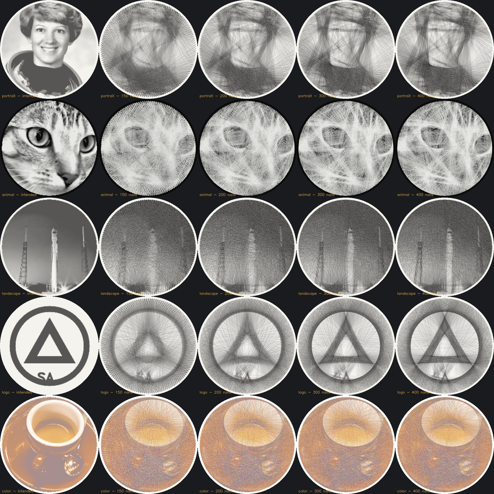

# StringArt Studio

Turn a photograph into a **physically buildable string-art plan**: numbered nails on a board, an
optimised thread sequence, a step-by-step simulator and the manufacturing files to make it.



It runs locally with no cloud services or paid APIs. A Python engine (NumPy, OpenCV, SciPy,
ReportLab) behind a FastAPI server powers a React + TypeScript UI.

## Quick start

```bash
./start.sh            # Linux/macOS (Windows: start.bat)
# open http://127.0.0.1:8765
```

On first launch, `start.sh` creates a virtualenv, installs `backend/requirements.txt` and builds the
frontend (Node 18+). Manual steps:

```bash
pip install -r backend/requirements.txt
cd frontend && npm install && npm run build && cd ..
cd backend && python -m stringart serve --port 8765
```

Command line (no UI):

```bash
cd backend
python -m stringart generate ../samples/animal_cat.png --nails 300 --preset white_on_black --out cat_out
python -m stringart generate ../samples/color_coffee.png --color cmyk --mode quality --route practical
```

For frontend development, run `npm run dev` in `frontend/`. It proxies `/api` to port 8765.

## What it does

| Stage | Highlights |
|---|---|
| Import | JPG, PNG, WEBP, TIFF, BMP, GIF; EXIF orientation; transparency composited |
| Analysis | Face detection, saliency-based subject centring, auto-zoom on faces, GrabCut subject segmentation, edge/detail maps, histogram and diagnostics |
| Adjustments | Crop, zoom, offset, rotation, exposure, brightness, contrast, gamma, local contrast (CLAHE), sharpening, noise reduction, threshold, invert, background keep/simplify/remove, edge/face/detail priority |
| Board | Circle, square or rectangle; diameter, margin, 50–1000 nails, nail Ø and height, clockwise/counter-clockwise numbering, nail 1 position |
| Thread | White on black, black on white, red on black, on wood, custom colours; thickness, fibre opacity, tone physics |
| Colour | Up to 12 real thread colours, CMYK and RGB-inspired palettes, perceptual ΔE (CIEDE2000) scoring, per-colour layers and routes |
| Generation | Greedy error minimisation in optical-density space: exact per-line gains, cached rasterised lines, no repeated connections, 6 modes (quality, balanced, min strokes, contrast, fast, custom), live progress, cancellation |
| Route | Graph analysis (degrees, components, Euler bound), minimum trail decomposition (Hierholzer), strict and practical modes, bridge proposals only applied after explicit approval, mathematical validation |
| Simulator | Real nail-to-nail order; play, pause, stop, restart, step ±1, jump, timeline, speed, current/next nail, colour layers on/off |
| Instructions | Searchable sequence table (find every step at a nail), click a row to jump the simulator |
| Materials | Thread length (chords + nail wraps + knots + slack + waste), spools, time, cost |
| Export | Construction manual PDF, full-scale and A4-tiled template PDF, template SVG, DXF, G-code drilling, sequence CSV (Excel) and JSON, nail coordinates CSV, PNG, JPG, SVG artwork, GIF, MP4, PNG step sequence, portable `.saproj` project |
| Projects | Save, reopen, duplicate, version history with compare, rename and delete, import and export |

## Repository layout

```
backend/stringart/   geometry, imaging, raster (line cache), engine (optimiser), color, route,
                     render, metrics, materials, pipeline, project, jobs, api, exports/
backend/tests/       pytest suite (41 tests)
frontend/src/        React UI: BoardCanvas, Simulator, SettingsPanel, RightPanel, App
scripts/benchmark.py validation over 5 images x 4 nail counts -> docs/benchmark/REPORT.md
docs/                ALGORITHMS.md (the maths), USER_GUIDE.md, benchmark/
samples/             test images (public domain / CC0 from scikit-image + a synthetic logo)
```

## Tests and benchmark

```bash
cd backend && python -m pytest -q        # 41 tests
python scripts/benchmark.py              # writes docs/benchmark/REPORT.md + contact sheet
```

The tests check that the exported step list re-renders exactly to the optimiser's selection. They also
check that every route uses each connection exactly once, and that the template and DXF coordinates
match the computed geometry to 0.001 mm.

## Honest limitations

* The quality indicators (SSIM, PSNR, MAE, ΔE) compare the simulation with the intended appearance.
  They are relative guides, not guarantees: real thread sheen, tension and lighting are not modelled.
* Portraits are the hardest subject for single-thread string art. Fine facial features stay soft at
  around 2,000–3,000 connections. Use **Max contrast**, crop tighter and simplify the background.
* The engine is vectorised NumPy on the CPU. GPU acceleration is not implemented: at the useful
  comparison resolutions (~200–300 px) a full run already takes 1–5 s.
* Square and rectangular boards are supported; other custom shapes are not yet.
* MP4 export depends on the local OpenCV build having an MPEG-4 encoder. GIF always works.
