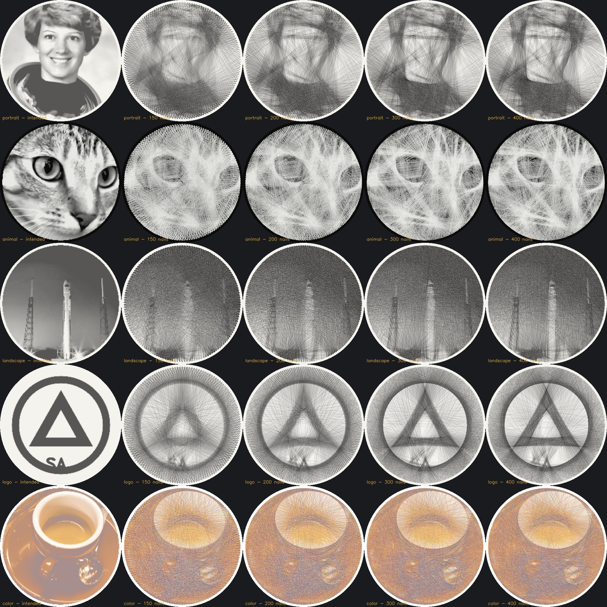

# Benchmark report

Generated by `scripts/benchmark.py` (mode: balanced, 300 mm circular board, 0.15 mm thread).

| Image | Nails | Connections | Sections | Thread (m) | Time (s) | Duplicates | Route valid | Sim = export | SSIM | PSNR (dB) | ΔE2000 | Error removed | Stop |
|---|---|---|---|---|---|---|---|---|---|---|---|---|---|
| portrait | 150 | 2203 | 1 | 600 | 0.8 | 0 | yes | yes | 0.672 | 18.3 | 7.4 | 83% | no_improving_line |
| portrait | 200 | 2242 | 1 | 612 | 1.1 | 0 | yes | yes | 0.701 | 19.0 | 6.4 | 86% | no_improving_line |
| portrait | 300 | 2265 | 1 | 622 | 1.7 | 0 | yes | yes | 0.709 | 19.0 | 6.2 | 87% | no_improving_line |
| portrait | 400 | 2266 | 1 | 623 | 2.4 | 0 | yes | yes | 0.710 | 19.0 | 6.2 | 88% | min_improvement |
| animal | 150 | 1890 | 1 | 511 | 0.7 | 0 | yes | yes | 0.525 | 15.3 | 9.6 | 78% | no_improving_line |
| animal | 200 | 1944 | 1 | 529 | 1.0 | 0 | yes | yes | 0.565 | 15.6 | 9.2 | 81% | no_improving_line |
| animal | 300 | 1980 | 1 | 538 | 1.5 | 0 | yes | yes | 0.585 | 15.7 | 8.9 | 83% | no_improving_line |
| animal | 400 | 1987 | 1 | 541 | 1.8 | 0 | yes | yes | 0.583 | 15.7 | 9.0 | 84% | no_improving_line |
| landscape | 150 | 3482 | 1 | 893 | 0.9 | 0 | yes | yes | 0.792 | 25.8 | 2.6 | 94% | no_improving_line |
| landscape | 200 | 3510 | 1 | 901 | 1.2 | 0 | yes | yes | 0.809 | 26.8 | 2.3 | 95% | no_improving_line |
| landscape | 300 | 3527 | 1 | 908 | 2.1 | 0 | yes | yes | 0.848 | 27.8 | 2.0 | 96% | no_improving_line |
| landscape | 400 | 3537 | 1 | 913 | 2.5 | 0 | yes | yes | 0.856 | 28.0 | 1.9 | 97% | no_improving_line |
| logo | 150 | 1777 | 1 | 486 | 0.5 | 0 | yes | yes | 0.555 | 13.7 | 13.8 | 59% | no_improving_line |
| logo | 200 | 1858 | 1 | 506 | 0.7 | 0 | yes | yes | 0.601 | 14.1 | 12.5 | 65% | no_improving_line |
| logo | 300 | 1922 | 1 | 524 | 1.1 | 0 | yes | yes | 0.631 | 14.1 | 11.8 | 68% | no_improving_line |
| logo | 400 | 1945 | 1 | 531 | 1.6 | 0 | yes | yes | 0.636 | 14.1 | 11.7 | 69% | no_improving_line |
| color | 150 | 4368 | 4 | 1102 | 2.1 | 0 | yes | yes | 0.799 | 25.5 | 4.1 | 79% | max_lines,no_improving_line,no_improving_line,no_improving_line |
| color | 200 | 4409 | 4 | 1112 | 2.5 | 0 | yes | yes | 0.820 | 25.7 | 3.9 | 80% | max_lines,no_improving_line,no_improving_line,no_improving_line |
| color | 300 | 4448 | 4 | 1122 | 3.4 | 0 | yes | yes | 0.830 | 25.8 | 3.7 | 81% | max_lines,max_lines,no_improving_line,max_lines |
| color | 400 | 4446 | 4 | 1131 | 4.7 | 0 | yes | yes | 0.832 | 25.7 | 3.7 | 82% | max_lines,no_improving_line,no_improving_line,max_lines |

*Duplicates*: repeated undirected connections in the selection (must be 0). *Route valid*: every selected connection used exactly once by the planned sections. *Sim = export*: the density re-rendered from the exported step list equals the optimiser's selection. Quality indicators compare the simulation with the intended appearance and are approximate.

## Assessment

* **Recognisability.** The logo, the cat (white on black), the rocket/launch-pad scene and the coffee cup
  (CMYK) are clearly recognisable at every nail count from 200 up; 150 nails already shows the main
  structure. The portrait is the weakest case: hair, collar, face shape and the eye line are visible, but
  fine facial features stay soft. That is a known limit of continuous single-thread string art at
  ~2,300 connections on a 300 mm board with 0.15 mm thread. The "Max contrast" mode, a tighter crop
  (Zoom) and Background → Simplify/Remove help portraits.
* **More nails** consistently raise SSIM and error reduction, with diminishing returns above 300.
* **Physical executability.** No duplicate connections. Every route is validated. Monochrome runs use
  one continuous thread. The CMYK run needs one section per colour, as expected.
* **Generation time** is 0.5-5 s per run on a 4-core CPU (NumPy, no GPU).
* **Stopping.** Most runs stop because no line from the current nail still improves the image
  (`no_improving_line`), not because of the line cap. The continuous route reaches the useful thread
  density on its own.
